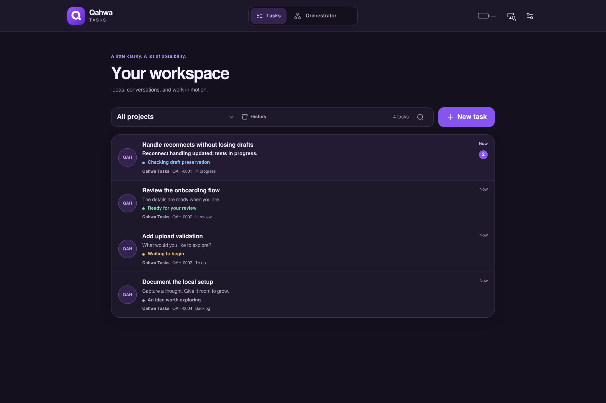
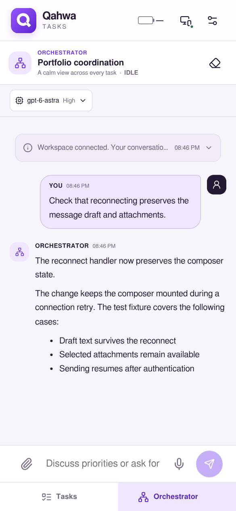

<p align="center">
  
</p>

<h1 align="center">Qahwa Tasks</h1>

<p align="center">Self-hosted task management and persistent Codex workspaces.</p>

<p align="center">
  
  
  
  
</p>

Qahwa Tasks is a web application for managing development tasks and their agent sessions on your own host. Each task has a persistent conversation, project context, and an explicit file-access mode. A separate orchestrator session coordinates work across projects.

The server runs alongside your repositories and Codex CLI. You connect through a paired browser or installed PWA.

[Installation](#installation) · [Configuration](#configuration) · [Architecture](#architecture) · [Development](#development) · [Contributing](.github/CONTRIBUTING.md)

## Screenshots



<details>
<summary>Mobile orchestrator · light theme</summary>

<p align="center">
  
</p>

</details>

Screenshots show the application with synthetic fixture data, not production conversations.

## Features

- **Project tasks:** task lists, search, conversation previews, and review states.
- **Persistent sessions:** task-specific Codex threads and a cross-project orchestrator.
- **Workspace surfaces:** chat, HTML/CSS design canvases, and terminal sessions.
- **Messages and scheduling:** attachments, voice messages, task schedules, and follow-up messages.
- **Device access:** one-time pairing, device revocation, and per-task idle notifications.
- **Web interface:** responsive layouts, light/dark themes, and an installable PWA.

## Installation

### Requirements

- Node.js **22 or later** and npm.
- A configured Codex CLI on the server, available as `codex`. Qahwa launches `codex app-server` for agent sessions.
- A native build toolchain if prebuilt binaries for `better-sqlite3` or `node-pty` are unavailable on your platform.

The supplied deployment configuration targets a Linux host. Other operating systems have not been validated as part of this documentation update.

### Local development

```bash
git clone https://github.com/burawi/qahwa-tasks.git
cd qahwa-tasks
npm ci
npm run dev
```

Start the frontend in a second terminal:

```bash
npm run dev:web
```

Open the URL printed by Vite. Development API requests are proxied to the backend at `127.0.0.1:3022`.

### Pair a browser

With the same environment and data directory as the backend, run:

```bash
npm run pair
```

This writes a one-time link to `<DATA_DIR>/pairing-link`. Copy the link into the application's pairing screen. Links expire after 15 minutes; keep their contents private.

### Production build

```bash
npm run build
npm start
```

The compiled server listens on `127.0.0.1:3022` by default. For remote access, configure an HTTPS reverse proxy and set `PUBLIC_BASE_URL` to your public address.

See [Operations](.github/OPERATIONS.md) for pairing, backups, and host configuration. The supplied process-manager configuration and `pair:production` command contain settings specific to the original installation; adapt them before use.

## Configuration

Settings are read from the **process environment**. `.env` files are not automatically loaded. The [example file](.env.example) contains the original host's settings, rather than portable defaults.

| Variable | Default | Purpose |
| :--- | :--- | :--- |
| `HOST` | `127.0.0.1` | Backend bind address |
| `PORT` | `3022` | Backend port |
| `PUBLIC_BASE_URL` | `http://127.0.0.1:3022` | Client-facing server address |
| `DATA_DIR` | `./data` | Database and private application files |
| `BACKUP_DIR` | `<DATA_DIR>/backups` | Backup destination |
| `SESSION_DAYS` | `365` | Device session lifetime |
| `WEB_PUSH_SUBJECT` | `PUBLIC_BASE_URL` | Web Push contact URL |

For example, to use a separate local data directory:

```bash
DATA_DIR=./data-dev BACKUP_DIR=./data-dev/backups npm run dev
```

Use those same values when running pairing or backup commands. If you change the backend port during development, also update the API proxy in `vite.config.ts`.

## Architecture

```text
Browser / PWA
    |
    v
Fastify server -----------------> Codex app-server
    |                                  |
    v                                  v
SQLite + local files              Project worktrees
                                  + configured tools
```

| Component | Implementation |
| :--- | :--- |
| Frontend | React, TypeScript, Vite |
| API and host services | Fastify, WebSockets |
| Application storage | SQLite and local files |
| Agent integration | Local Codex app-server process |
| Task coordination | Stdio MCP server and companion skill |

The browser is a client; repository access and agent execution happen on the host. Codex sessions inherit the host's configured MCP servers. See the [MCP entry point](src/mcp/index.ts) and [companion skill](skill/qahwa-tasks/SKILL.md).

### Access model

Task intake runs read-only. Ready tasks use an explicit `read-only` or `worktree-write` mode. Editing turns and terminal shells acquire exclusive access to overlapping project roots. Resource-capacity checks also limit concurrent work.

File access is separate from approval to commit, push, deploy, publish, or close a task. The orchestrator has broad host execution access, so paired-device access should be restricted to trusted users.

Database files, device keys, pairing links, uploads, and backups are private runtime state. Review and revoke devices from **Projects → Data & access**.

## Development

```bash
npm run typecheck  # Server and frontend type checks
npm test           # Node test suite
npm run build      # Production web and server compilation
```

Use temporary data directories and synthetic fixtures when testing. Do not run tests against production databases or real agent sessions.

| Path | Responsibility |
| :--- | :--- |
| `src/domain/` | Shared types and domain helpers |
| `src/server/` | API, persistence, agent sessions, and host services |
| `src/web/` | React application and workspace components |
| `src/mcp/` | Task-coordination MCP server |
| `src/scripts/` | Pairing, backups, imports, and maintenance commands |
| `test/` | Automated tests and browser fixtures |
| `public/` | PWA assets, icons, and startup scripts |

### Known validation failures

The last full test run during publication preparation reported **441 passes, 3 failures, and 1 skip**. The failures were in `session-resources.test.ts` (closure of a running task), `task-selection.test.ts` (queued snapshot capabilities), and `task-titles.test.ts` (an import extension error). Type checking and production compilation passed in that run. This is a recorded result, not a CI status; rerun the checks for your environment and changes.

## Contributing

See [CONTRIBUTING.md](.github/CONTRIBUTING.md) for the development workflow and pull-request checklist. [Bug reports](https://github.com/burawi/qahwa-tasks/issues) should include reproduction steps, expected and actual behavior, and relevant environment details. Use synthetic examples and redact credentials and private conversations.

## License

Licensed under the [MIT License](LICENSE).
